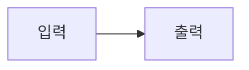

# 렌더링 검증 자료

공개 글 목록에 포함하지 않는 검증용 자료입니다.

| 단계 | 값  |
| ---- | --- |
| 입력 | 1   |
| 출력 | 2   |

```javascript
const result = [1, 2].map((value) => value * 2)
```

인라인 수식 $x^2 + y^2 = z^2$와 블록 수식을 확인합니다.

$$
\frac{1}{2} + \sqrt{x}
$$


